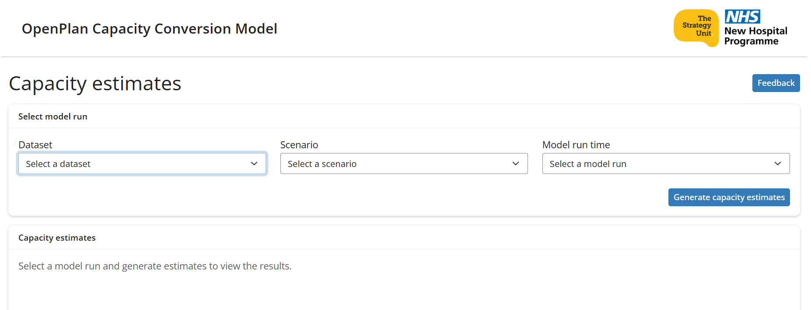
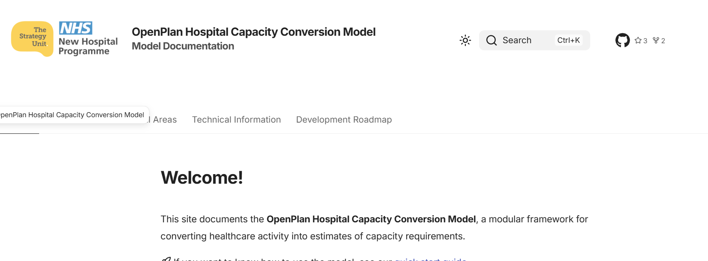

## The problem with estimating capacity needs

<p class="fragment">How does this work?</p>
<p class="fragment">Why do my results differ?</p>
<p class="fragment">Something changed - What? Why? When?</p>
<p class="fragment">Who decided that? Why?</p>

:::{.notes}
What we're hearing from you is that when estimates of capacity from demand data are needed, currently the following questions are popping up.
:::
##
```{=html}
<script src="https://kit.fontawesome.com/954a9d9f43.js" crossorigin="anonymous"></script>
```

## TRUST

<style>
.concepts {
  display: flex;
  flex-direction: column;
  gap: 0.55em;
  margin-top: 0.7em;
}

.concept {
  display: grid;
  grid-template-columns: 1.4em auto;
  align-items: center;
  column-gap: 0.35em;
  font-size: 1.15em;
}

.concept i {
  font-size: 0.8em;
  opacity: 0.65;
}
</style>

<div class="concepts">

<p class="fragment concept">
  <i class="fa-solid fa-triangle-exclamation"></i>
  <strong>VARIABILITY</strong>
</p>

<p class="fragment concept">
  <i class="fa-solid fa-box"></i>
  <strong>BLACK BOX</strong>
</p>

<p class="fragment concept">
  <i class="fa-solid fa-magnifying-glass"></i>
  <strong>NON-AUDITABLE</strong>
</p>

<p class="fragment concept">
  <i class="fa-solid fa-fingerprint"></i>
  <strong>ONE-OFF</strong>
</p>


</div>

:::{.notes}
Fundamentally there is a problem with Trust
You need the capacity conversions to 'show their working' so you can trust that its correct and appropriate.

But Trust is hard to come by when across the piste capacity conversion is 

VARIABLE 
- some are simple worksheets, some more sophisticated approaches but they are fundamentally not comparable

BLACK BOX 
- The underlying decision making, the judgement calls, and the assumptions that have gone into the approach are not available for scrutiny.

NON-AUDITABLE
- Cannot audit their approach fully: were their methods sound? Do they work for all cases you need to put them to? Can you fully understand its limitations?Are their assumptions justified?
- This potentially leaves the method open to manipulation/error

ONE-OFF
- often the approach is not reusable, so the money spent on its procurement cannot benefit future applications. 

:::

## What we believe

<div class="r-stack">

  

  

  

  

</div>

:::{.notes}
We intend to address all of these issues with our OpenPlan Hospital Capacity Model

We believe in working **transparently**
Our approach is to create something that is transparent;
in our choices
in the methods
in the limitations
This is why we code IN THE OPEN - anyone can dig into the machine and question our choices.

We actively seek input from experts
- to **VALIDATE** that our approach is 
correct
- applicable to the widest user group

We believe that the hard work should be on us.
You have enough to handle in your own roles, understanding our methods deeply shouldn't be needed for you to trust them.
We try to maxise our tools' impact through **friction-free** use, by which I mean we go to lengths to build tools that
- can be understood by a motivated layman
- prevent accidental misuse 
- are supported by accessible content that helps you interpret your results so you're not left guessing about what to do next
We want to help you to 'show your working' to those who would require it, by us 'showing our working' to you.

We believe in being honest about **uncertainty**.
We respect that predicting the future is hard and is subject to uncertainty, that's a fact of life.
We don't wish that uncertainty away, we don't pretend its not there, we don't deal in spurious certainty.
We acknowledge it, bake it in to our methods and make sure that what we produce are forecasts that include that uncertainty. 
That way we respect your local intelligence that can be brought to bear to make realistic and mature choices based on what we forecast.

We believe that you shouldn't need to be a **statistician** to have trust in our statistical approaches.
We do that by repeatedly, openly, validating and verifying our work with relevant experts, recording their findings and acting on anything that requires change.

We belive in maximising **value for money**
Taxpayer's funds must be respected, and if we can build tools that are reusable, all the better.
Our approach is therefore to build in such a way that
- allows updates and extensions easily (it won't break when new data are released)
- makes succession planning easy - you don't need to rely on that one guy in the office who 'knows how to to the thing', everything someone new needs to know about our tools should be simple to pick up. No more costly loss of institutional memory if someone in your team moves on.

:::

## OpenPlan Hospital Capacity Model


:::{.notes}
All those beliefs I talked about there were how we approached building the NHP demand model. That model was awarded the 2025 Florence Nightingale Award for Excellence in Health and Care Analytics by the Royal Statistical Society and the Health Foundation.

In that award, they cited its strengths as being:
- "nationally consistent"
- "open-source" (fully transparent)
- "statistical robust"
- "impact, especially in driving improvements for patients."
- "published a wealth of information and resources in easily accessible forms"
- "reflects real-world uncertainty"
- "it promotes transparency, trust, and alignment with local transformation plans"
It was called an "unusually strong piece of applied NHS analytics".

We plan to leverage all of that benefit with our capacity conversion model.

:::

## OpenPlan Capacity Model

<style>
.icon-grid {
  display: grid;
  grid-template-columns: repeat(3, 160px);
  grid-template-rows: repeat(2, 160px);
  gap: 40px;
  justify-content: center;
  align-items: center;
  margin-top: 100px;
}

.icon {
  font-size: 120px;
  text-align: center;
}

.icon-label { display: block; width: 100%; margin-top: 4px; font-size: 30px; line-height: 1.2; font-weight: 600; white-space: nowrap; text-align: center; }


</style>

<div class="icon-grid">

<div class="icon fragment">
  <i class="fa-solid fa-folder-open"></i>
  <span class="icon-label">Transparent</span>
</div>

<div class="icon fragment">
  <i class="fa-solid fa-dumbbell"></i>
  <span class="icon-label">Robust</span>
</div>

<div class="icon fragment">
  <i class="fa-solid fa-square-check"></i>
  <span class="icon-label">Validated</span>
</div>

<div class="icon fragment">
  <i class="fa-solid fa-tornado"></i>
  <span class="icon-label">Uncertainty</span>
</div>

<div class="icon fragment">
  <i class="fa-solid fa-sliders"></i>
  <span class="icon-label">Versatile</span>
</div>

<div class="icon fragment">
  <i class="fa-solid fa-key"></i>
  <span class="icon-label">Accessible</span>
</div>

</div>

<link rel="stylesheet"
      href="https://cdnjs.cloudflare.com/ajax/libs/font-awesome/6.5.1/css/all.min.css">

:::{.notes}


Lets briefly touch on how those elements are being enacted with the model we're building you.

**Transparent**
- Our codebases are open code by default, meaning anyone can come and inspect any element of it, and see the decision making and discussions that have gone into a lot of it.
- We also host up to date open Quality Assurance logs and plans (in line with the government digital standards and National Audit Office approaches)
- All assumptions will be published alongside their justifications
- All limitations are clearly stated and explained - plus we provide a roadmap of future work that aims to address them where possible.

**Robust**
We involved from the start a multi-disciplinary team of experts to guide us towards an agreed methodology.  
The whole thing is openly version controlled, which means that when things change, we can always turn back the clock to find out exactly when/what/who and why of every change.

**Validated**
We are validating the work as we go.
This involved a panel including -clinical colleagues, data engineers, analysts, methodology experts, statisticians,
user experience experts, and, crucially, real users. 

**We Account for uncertainty**
by sitting the capacity conversion on top of the demand model - it therefore 
inherits all the uncertainty considerations that are pivotal to that model.
We also have plans to incorporate futher sources of uncertainty as part of our future work plans.

**Adaptible**
We have created the tool in a way that makes future developments smooth and simple, ensuring we can keep up with updated data flows and new sources of robust information. This means the tool has longevity, should be of genuine utility to a broad anad changing audience, and reflects value for money.

**Accessible**
We are designing the user elements with real people in mind - there should be no need to have the skills of our MDT, we want the tool to be unintimidating, useful and fool proof so the results you get are used to best effect.
Crucially we're avoiding guesswork about how users want to receive the tool - we are asking them, iteratively, to ensure we stay on the right lines and end up with something truly impactful

We aim to deliver value on day 1, and to continue to increase that value over time.
:::

## Progress so far


<style>
.progress-container {
  position: relative;
  height: 450px;
}

.progress-pair {
  position: absolute;
  inset: 0;
  display: flex;
  align-items: center;
  justify-content: space-between;
}

.progress-text {
  width: 50%;
  font-size: 1.4em;
  text-align: left;
}

.progress-pair img {
  width: 500px;
  height: auto;
  max-height: 350px;
  object-fit: contain;
  margin-left: auto;
}
</style>

::: {.progress-container}

::: {.progress-pair .fragment .current-visible}
::: {.progress-text}
An online application interface
:::


:::

::: {.progress-pair .fragment .current-visible}
::: {.progress-text}
Near instant results workbook downloadable
:::

.jpg)
:::

::: {.progress-pair .fragment .current-visible}
::: {.progress-text}
A user tested comprehensive supporting documentation website
:::


:::

::: {.progress-pair .fragment .current-visible}
::: {.progress-text}
Development roadmap
:::


:::

:::

:::{.notes}
SLIDE
We are on tract to release version 1 in October. 

This first version will include
- an online **application** on our Connect platform that will allow people who have run demand models in the past to easily select from their past scenarios one which they want to convert. 

- Results will be created and available for download near instantaneously, int he form of a **workbook**. this workbook will clearly state the values of ALL assumptions used, as well as the conversion results.

- A full supporting **documentation** website will be availab that explains, in both layman-friendly and technical terms how the model works, what it provides, and all limitations.
This will be kept up to date with explanations of how the conversion model has changed over time. The site includes all assumptions inherent in the model alongside their justifications.

- and the high-level development **roadmap** so you will always know what improvements are coming up. 

- On day 1 users will have the facility to submit **feedback** on the model and the documentation site, which will be triaged and acted upon subject to our comprehensive feedback review system.

The process has been devised, tested, and iteratively improved upon for accuracy,
robustness, security and user experience.

I'll pass over to my colleague Paul now and let him tell you about the conceptual framework he has built.

:::

## OpenPlan Capacity Model Conceptual Framework (1/2)
## OpenPlan Capacity Model Conceptual Framework (2/2)

## Future plans

- Queueing theory
- New data feeds 
- A results dashboard
- Replacing assumptions with local operational parameters
- Evaluation of SoA alignment
- Baseline conversion

:::{.notes}
Our aims with version 1 of the model are to release a prototype that will deliver
value from day 1.
We are constantly prioritising potential extensions to ensure the roadmap is
taking us towards a tool that makes everyone's lives easier.


- Queueing theory to better account for unpredictable demand
- Incorporating new data feeds to remove some of the assumptions: criticial care,
diagnostic imaging.
- A results dashboard to deliver useful visualisations of output
- Allowing local operational parameters to be ingested instead of relying on 
central assumptions
- Appraisal of the elements of SoA that are not yet covered to identify opportunities
to incorporate those.
- comparison of baseline year capacity estimates to known physical capacity 

As well as those extensions, what comes with the model includes:

- seamless integration with the demand model - all improvements and updates there
will allow improvement in the capacity model results

:::

## Over to you....

- Tell us what you think!
- Whats useful? Whats not?
- What would you like to see added?
- Does it work for your scenario?

